<picture>
  <source media="(prefers-color-scheme: dark)" srcset="assets/hero-dark.svg">
  
</picture>

## Yurii Shchehliuk · Senior Full-Stack Engineer

**C# / .NET · Angular · Next.js · Azure** · Chicago, IL · [LinkedIn](https://www.linkedin.com/in/yurii1exe/) · [yshchehliuk@gmail.com](mailto:yshchehliuk@gmail.com)

I build the integration layer: the code that sits between systems that were never
designed to talk to each other, and has to be right every time: databases, APIs,
queues, devices and partner feeds on one side; the Angular and Next.js apps
people actually use on the other. Logistics, healthcare, manufacturing and
e-commerce so far. Everything below has tests and CI.

 

<a href="https://github.com/yurii1exe/edi-x12-toolkit"><picture>
  <source media="(prefers-color-scheme: dark)" srcset="assets/card-edi-x12-toolkit-dark.svg">
  
</picture></a>

A .NET parser and validator for ANSI X12, the EDI format US freight runs on. Most
X12 code hardcodes `*` and `~` and breaks on the first partner that uses pipes.
This one reads the delimiters from the ISA header the way the standard intends,
and reports envelope errors such as a wrong SE01 segment count (a common reason
a partner rejects a file) as named diagnostics. It ships as a library, a
`dotnet` CLI tool, and a playground that runs the same parser compiled to
WebAssembly. **[▶ Try it live](https://yurii1exe.github.io/edi-x12-toolkit/)**

  

<a href="https://github.com/yurii1exe/freight-dispatch-board"><picture>
  <source media="(prefers-color-scheme: dark)" srcset="assets/card-freight-dispatch-board-dark.svg">
  
</picture></a>

The loop every freight brokerage runs, built end to end: a load tender (EDI 204)
comes in and gets acknowledged, a dispatcher works the load stop by stop, every
status change emits the 214 that reports it, and an invoice closes it out. Every
outbound document is re-parsed before it's shown, so the board never displays a
file that a trading partner would reject.

  

<a href="https://github.com/yurii1exe/opc-ua-monitor"><picture>
  <source media="(prefers-color-scheme: dark)" srcset="assets/card-opc-ua-monitor-dark.svg">
  
</picture></a>

Live monitoring for industrial equipment. A .NET service subscribes to an OPC UA
server and streams node values to a live Angular dashboard. When a connection
drops, it keeps showing the last values but marks them as stale, so nobody reads
old data as current.

  

#### Also

**[fmcsa-carrier-check](https://github.com/yurii1exe/fmcsa-carrier-check)**: Next.js 15 / React 19 carrier vetting on the public FMCSA API, covering authority, insurance, safety rating and inspections. 188 tests.

**[ECommerce-Restaurant](https://github.com/yurii1exe/ECommerce-Restaurant)**: .NET microservices with MassTransit/RabbitMQ, Redis, EF Core, JWT and Angular, all running under one Docker Compose file.

#### Stack

| | |
|---|---|
| **Backend** | C# · .NET 8 / 6 · ASP.NET Core · EF Core · REST · SignalR · RabbitMQ / MassTransit · Node.js |
| **Frontend** | Angular · RxJS · TypeScript · React · Next.js |
| **Data** | SQL Server · T-SQL · PostgreSQL · MongoDB · Redis |
| **Cloud & DevOps** | Azure (App Service, Functions, Event Hub, IoT Hub, Key Vault) · Docker · CI/CD · GitHub Actions |
| **Integration** | EDI ANSI X12 · CargoWise · TMW · OPC UA · DICOM · HL7 |

 

<a href="mailto:yshchehliuk@gmail.com"><picture>
  <source media="(prefers-color-scheme: dark)" srcset="assets/contact-dark.svg">
  
</picture></a>
